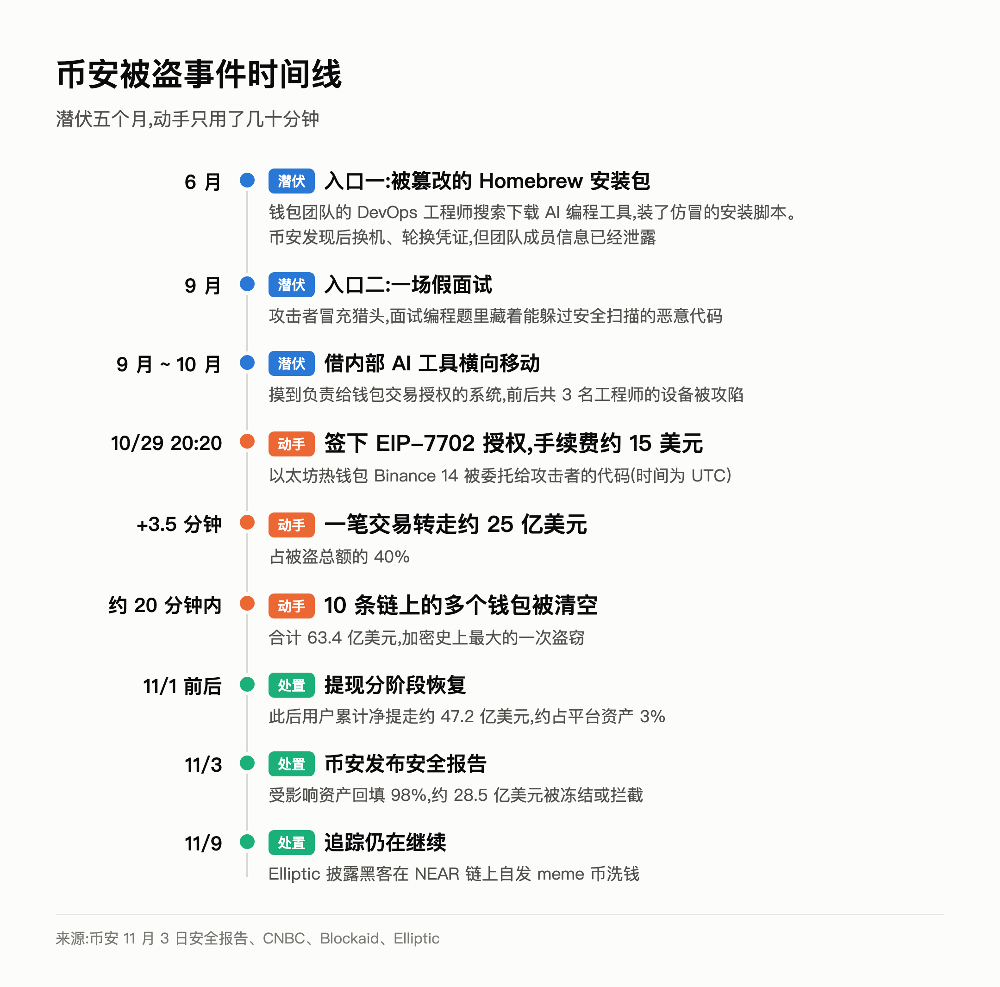
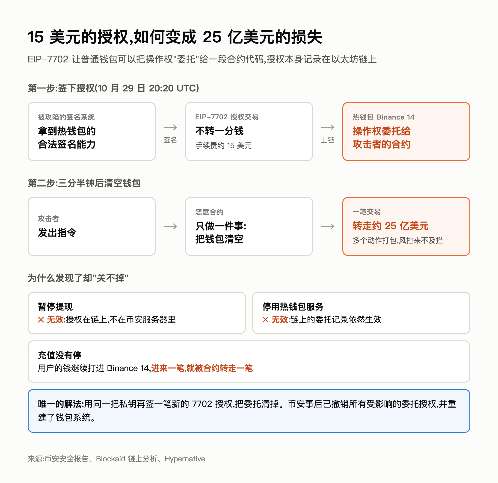
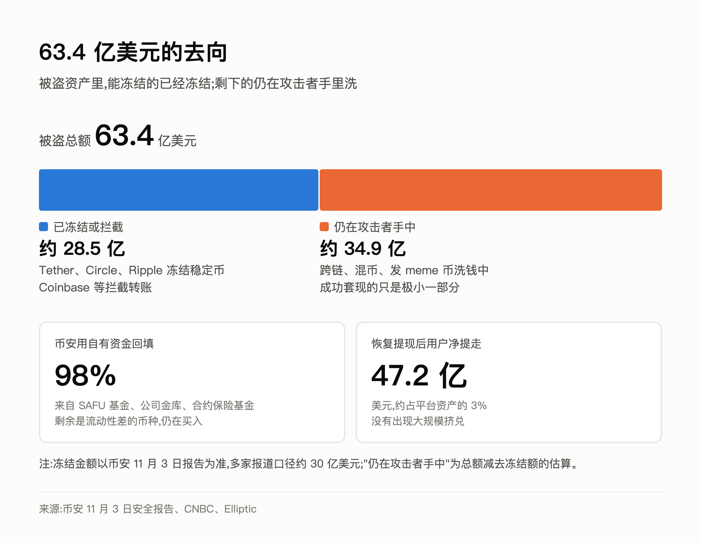
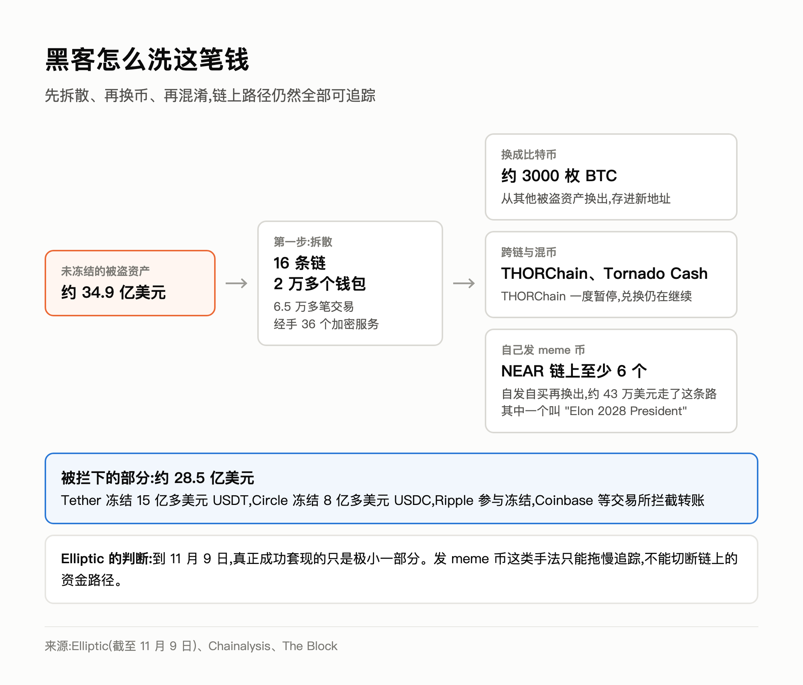

# 一场假面试,如何打开史上最大加密劫案

10 月 29 日晚上,币安的热钱包开始往外流钱。

最早的消息说"被盗超过 20 亿美元"。几个小时后,链上安全团队把数字改成"可能高达 55 亿";又过了几天,币安自己的报告给出了最终数字:**63.4 亿美元**,约合人民币四百多亿元。

这是加密货币史上最大的一次盗窃,是去年 Bybit 被盗 15 亿美元的四倍多。

更让人后背发凉的是攻击的细节:黑客在币安内部潜伏了五个月,入口是一场假面试;真正动手转走第一笔 25 亿美元,只用了三分半钟,手续费大约 15 美元。

这篇文章把整件事回顾一遍:黑客是怎么进来的,钱是怎么被转走的,为什么币安发现了却"关不掉",事后币安做了哪些处理,以及到现在为止,这件事进展到了哪一步。

---

## 一、五个月的潜伏

### 6 月:一个被篡改的安装包

故事的开头,和你我每天都在做的事一模一样。

币安钱包团队的一名 DevOps 工程师,想装一个 AI 编程工具。他在搜索引擎上搜到了下载地址,按页面提示用 Homebrew 安装。问题是,那个页面是攻击者伪造的,安装脚本被动过手脚。

币安的安全系统当时其实发现了异常,换掉了这台电脑,也轮换了相关凭证。看起来事情已经处理完了。

但攻击者已经拿到了一样东西:**这名工程师在钱包基础设施团队里的角色,以及他周围同事的信息。** 他们知道下一步该找谁了。

### 9 月:一场假面试

三个月后,攻击者伪装成猎头,联系上钱包团队的另一名工程师,安排了几轮"面试"。面试的最后一环是一道编程题,题目附带的代码里藏着恶意程序,而且专门做过处理,能躲过安全扫描。

币安联合 CEO 何一(Richard Teng)接受 CNBC 采访时说:"他们花了好几个月,一步一步往里钻。"

接下来,攻击者通过被攻陷的设备进入了币安的**内部 AI 工具**,并借此摸到了负责给钱包交易授权的系统。币安的报告里,前后一共有三名工程师的设备被攻陷。

### 10 月 29 日:动手

到这时,攻击者已经具备了让币安的钱包"自己签字"的能力。剩下的,就是挑一个时间动手。

---

## 二、三分半钟,25 亿美元

### 15 美元的那笔交易

UTC 时间 10 月 29 日晚上 8 点 20 分左右,一个叫 "Binance 14" 的以太坊热钱包发出了一笔交易。

这笔交易没有转走一分钱,手续费大约 15 美元。它做的事情只有一件:**用这个钱包的合法签名,授权一段攻击者写的代码,今后可以代表这个钱包操作。**

三分半钟后,这段代码发起了一笔交易,把钱包里约 25 亿美元的资产一次性转走,占这次被盗总额的 40%。

### 这个"授权"是什么

这里要说一个技术背景:**EIP-7702**。

以太坊上的普通钱包(外部账户),原本只能一笔一笔地发交易,不能运行代码。2025 年 5 月以太坊的 Pectra 升级引入了 EIP-7702:钱包主人签一个授权,就可以把自己的钱包"委托"给一段智能合约代码。之后,这个钱包就能像智能合约一样,把多个动作打包在一笔交易里执行。

这个功能本来是好东西:批量操作、代付手续费、更灵活的权限管理,都靠它实现。

但反过来想:**如果签下这个授权的不是钱包主人,而是拿到了签名能力的黑客呢?** 钱包就被交给了一段只做一件事的代码——收到指令,把钱包清空,转到指定地址。

安全公司的复盘里有一句话很直白:7702 让黑客转移资产"转得更快"。原本要一笔一笔转、每一笔都可能被风控拦下,现在一笔交易就打包完成了。

### 为什么发现了却关不掉

更麻烦的是后面发生的事。

币安很快发现了异常,暂停了提现,停用了热钱包服务。按以往的经验,"拔掉网线"之后,黑客就转不动了。

这次不一样。**EIP-7702 的授权是写在以太坊链上的**,不在币安的服务器里。币安关掉自己的系统,链上那条"这个钱包归这段代码管"的记录依然有效。要撤销它,必须用同一把私钥再签一个新授权,把委托清掉。

与此同时,充值业务没有受影响,用户的钱还在源源不断地打进 Binance 14。进来一笔,就被代码转走一笔。

币安事后的报告承认,关闭提现和停用热钱包服务,都没法自动撤销这个授权。最终,攻击者在 10 条区块链上,对币安的多个钱包动了手,大部分资金在大约 20 分钟内被转走。

---

## 三、是谁干的

FBI、Chainalysis、Elliptic、TRM Labs 的结论一致:朝鲜黑客组织 **TraderTraitor**,也就是常说的 Lazarus 旗下的一支。

判断依据之一,是被盗资金在链上和上个月 Bitget 被盗的资金混在了一起。手法也很眼熟:去年 Bybit 被盗 15 亿美元,同样是先攻陷开发人员的电脑,再在签名环节动手脚。

11 月 3 日,金正恩的妹妹金与正发表声明,否认朝鲜参与。

---

## 四、这件事给我们的几个提醒

### 对写代码的人

这次的入口,不是什么高深的零日漏洞,而是两件每个工程师都做过的事:**在网上搜一个工具装上,以及参加一场面试、做一道题。**

- **装工具只认官方渠道。** 搜索结果里的下载页可能是广告位,也可能是仿冒站。Homebrew、npm、pip 这类包管理器装东西,尽量直接用官方命令,别复制来路不明页面上的一长串脚本。
- **面试题、"测试项目"别在工作电脑上跑。** 朝鲜黑客用假招聘做敲门砖已经好几年了,目标就是有权限的工程师。真要做题,开一个虚拟机或者干净的容器。
- **AI 工具是新的攻击面。** 这次攻击者借内部 AI 工具摸到了签名系统。给 AI 工具接权限时,要按"一个新同事"的标准来:只给它完成工作需要的最小权限。

### 对做钱包、做链上系统的人

- **"拔网线"不等于止损。** 链上的授权、委托、approve 都不在你的服务器里,关掉系统不会让它们失效。应急预案里要写清楚:出事时怎么在链上撤销授权、谁有权限签、多快能签出来。
- **对 EIP-7702 授权单独监控。** 一个热钱包突然签了一笔委托授权,本身就应该触发最高级别的告警,而不是等到大额转账才发现。
- **热钱包的钱尽量少。** 这次热钱包里放了几十亿美元,一旦失守,损失就是这个量级。

### 对普通用户

- 按目前的报道,币安用户的资产不受影响,提现已经正常。
- 最近会有大量冒充"币安客服""被盗补偿登记"的钓鱼短信和链接。**币安不会让你点链接登记补偿,也不会要你的助记词和验证码。**
- 交易所再大也有风险。长期不交易的资产,放在自己掌控私钥的钱包里更稳妥。

---

## 五、后续处理与最新进展

### 币安的处置

**1. 先承诺:损失由币安承担。** 事发后,币安第一时间表态用户资产不受影响,全部损失由公司自己承担。

**2. 用自有资金回填。** 钱从三块来:用户安全资产基金(SAFU,一个约 10 亿美元规模的比特币储备)、公司金库、合约保险基金。币安用这些钱去市场上买回被盗的币种,把每个币种的缺口补上。按 11 月 3 日的更新,受影响资产已经**回填了 98%**,剩下的是一些流动性差、不好买的币,还在继续买。

**3. 储备金证明扩容。** 储备金证明的快照扩大到 44 种代币,方便外界核对币安手里的资产是否足额。

**4. 冻结和拦截。** 被盗资产里有不少稳定币,而稳定币的发行方可以在链上冻结特定地址。Tether 冻结了超过 15 亿美元的 USDT,Circle 冻结了超过 8 亿美元的 USDC,Ripple 也参与了,Coinbase 等交易所拦截了流向攻击者地址的转账。币安给出的数字是约 **28.5 亿美元**被冻结或拦截,多家报道的口径在 30 亿美元左右。

**5. 修系统。** 撤销了链上的委托授权,重建了受影响的钱包系统和内部 AI 工具,换掉所有被攻陷的设备,吊销相关工程师的凭证,扩大了对员工设备的安全扫描,并请独立专家做全面审查。

**6. 分阶段恢复提现。** 提现在 11 月 1 日前后分阶段恢复。恢复之后,用户累计净提走约 47.2 亿美元,大约是平台资产的 3%。对一场史上最大的盗窃来说,这个数字不算挤兑。

### 黑客那边:还在洗钱

63 亿里,约 30 亿被冻结,剩下的 30 多亿,攻击者正在洗。

据 Elliptic 截至 11 月 9 日的追踪,洗钱动用了 16 条区块链上的 2 万多个钱包、6.5 万多笔交易、36 个加密服务。能看到的手法包括:

- **跨链换成比特币。** 已有约 3000 枚 BTC 从其他被盗资产换出,存进了新地址。
- **通过 THORChain、Tornado Cash 等跨链和混币工具打散资金。** THORChain 一度暂停,但兑换仍在继续;隐私协议 Privacy Cash 在 11 月 4 日以此事为由暂停了充值。
- **自己发 meme 币来洗钱。** 黑客在 NEAR 链上新发了至少 6 个 meme 币,名字五花八门,其中一个叫 "Elon 2028 President"。原理是自己发币、自己用赃款买、再换成别的币,让资金流看起来像正常交易。Elliptic 说,这招只能拖慢追踪速度,链上的路径其实全都看得见。

Elliptic 的判断是:到目前为止,真正成功套现的只是极小的一部分。但从朝鲜过去几次的节奏看,他们不着急,会花几个月甚至几年慢慢洗。

### 其他后续

- **市场影响。** 消息传出后比特币一度跌到 76,368 美元,是六周来的最低点,之后有所回升。
- **人事。** 事发后几天,币安任命了新的首席财务官,并表示这次人事调整在被盗前几个月就已经定下。
- **行业影响。** 灰度的研究负责人估算,这次事件让 2026 年加密行业的安全损失超过 80 亿美元,创下新高。

### 还没算完的账

- 被冻结的约 30 亿,最终能还回来多少、多久还回来,还没有结论。
- 未冻结的 30 多亿仍在洗,能拦下多少要看接下来几个月的追踪。
- 币安自己最终的净损失是多少,还没有公布。赵长鹏在采访里的估计是"可能比 10 亿美元略多一些"。

**一句话总结:用户这一侧基本处理完了,黑客那一侧,还远没有结束。**

---

从 2022 年 Ronin 被盗 6 亿美元,到 2025 年 Bybit 被盗 15 亿美元,再到这次币安被盗 63 亿美元,金额一次比一次大,而入口始终是同一类东西:**人**。被骗下载的工具,被骗参加的面试,被骗签下的授权。

技术在进步,攻击也在进步,但最薄弱的那一环,一直是我们自己。

---

*数据来源:币安 11 月 3 日安全报告,CNBC 对何一的采访,Blockaid、Elliptic、Chainalysis、TRM Labs 的链上分析,以及彭博、新浪财经、华尔街见闻等的报道。金额以事件发生时的币价计算,各方口径略有差异,进展截至 11 月 9 日。*
